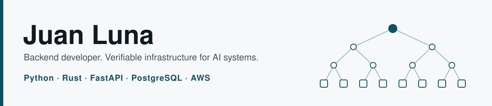
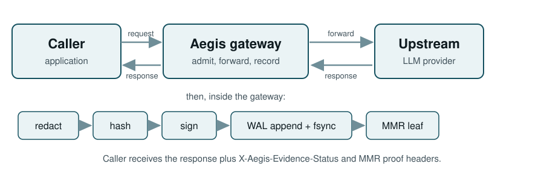

<picture>
  <source media="(prefers-color-scheme: dark)" srcset="assets/header-dark.svg" />
  <source media="(prefers-color-scheme: light)" srcset="assets/header-light.svg" />
  
</picture>

# Juan Luna

**Backend developer (Python, Rust). I build verifiable infrastructure for AI systems: an evidence gateway for LLM calls and the SaaS control plane around it, developed with Claude Code, with every number tied to a command and a date.**

Rosario, Argentina. Open to remote roles. [Contact](#contact) · [aegislatent.com](https://aegislatent.com)

*Una línea en español:* desarrollador backend que construye y opera de punta a punta un producto de infraestructura para IA, con cada cifra respaldada por un comando y una fecha.

## What I build

I work on systems where **the interesting part is the proof, not the API call**: infrastructure that keeps being *checkable* when the person reading the evidence does not trust the person who produced it.

I build and operate one product end to end: a gateway, a multi-tenant control plane, a multilingual website, a browser extension and the cloud infrastructure behind them. Nothing here is a slide. The public parts link to code you can read and measurements you can re-run; the private parts are described by capability, with their limits.

## Flagship: aegis-latent-core

[**aegis-latent-core**](https://github.com/JuanLunaIA/aegis-latent-core) is an OpenAI-compatible gateway (Python, FastAPI, asyncio, Rust core through PyO3) that sits between an application and an LLM provider. It applies policy to each request and records every governed call in a signed, hash-linked, append-only ledger. An outside party can check a disclosed record against a root they obtained independently, without trusting the gateway or the operator.

- **Inclusion proofs.** Each record is a leaf in a Merkle Mountain Range, with `O(log n)` proofs for a disclosed leaf. A proof does not establish confidentiality, identity, time, custody or external anchoring.
- **Offline verification.** A [313-line Python verifier](https://github.com/JuanLunaIA/aegis-latent-core/blob/main/sdk/python/src/aegis_sdk/proof.py) and a 295-line TypeScript twin validate proofs with no network call.
- **Fail-closed.** In strict mode, a missing signer or a ledger that fails to replay means no service, never silent unevidenced traffic. Strict mode depends on how it is configured and deployed.
- **Evidence signing.** HMAC-SHA256 by default; ML-DSA-65 (FIPS 204) where configured.
- **Guardrails.** Two-layer WAF against prompt injection, PII/PHI redaction including SSE streams, red-team tests and fuzz campaigns. Aegis detects tampering; it does not prevent it.
- **Boundaries in the open.** Public claims live in a [matrix of 131 claims](https://github.com/JuanLunaIA/aegis-latent-core/blob/main/docs/CLAIMS_MATRIX.md), each with a status and its limits, checked by a script. Regulatory frameworks are treated as technical input, not compliance: no certification is claimed.

<picture>
  <source media="(prefers-color-scheme: dark)" srcset="assets/flow-dark.svg" />
  <source media="(prefers-color-scheme: light)" srcset="assets/flow-light.svg" />
  
</picture>

*Diagram in words: the gateway admits or refuses a request, forwards it, then redacts, hashes, signs and durably commits the record to the ledger. For non-streaming responses the record is committed before the caller sees the response.*

### Measured

Baseline 5.0.1, run on 2026-09-24 on one shared 4-CPU container (CPython 3.11.15) with a real WAL `fsync` per commit. Method and raw record: [`docs/BENCHMARKS.md`](https://github.com/JuanLunaIA/aegis-latent-core/blob/main/docs/BENCHMARKS.md).

| Measurement | Result | Scope |
|---|---|---|
| Evidence commit latency (n = 1,000) | p99 1.22 ms (p50 0.62 ms, p95 1.00 ms) | Merkle append, HMAC signature and one `fsync` per commit |
| Commit throughput, 10 threads | 1,727 commits/s | One process, one WAL, one writer; does not scale with threads, by design |
| Memory, 1,000 concurrent SSE streams | +20.1 MB RSS | In-process streams; excludes network sockets and durable-WAL cost |
| Tests, `pytest -n auto -q` | 7,444 passed, 39 skipped, 0 failed; 91.30 % statement coverage | 5.0.1 tree, 2026-09-24; not re-run for 5.1.0 |

These are measurements on one host, not capacity or production claims.

### Release and license

- **Latest published release: 5.1.0, on 2026-11-19.** Signed tag, GitHub Release with 31 assets, PyPI, npm and GHCR were read back that day. Sigstore/cosign signature checks were run for 5.0.1 and 5.0.3; they have not been run for 5.1.0.
- **License:** the gateway is **source-available** under the Aegis Commercial License 1.0; the Python and TypeScript SDKs are Apache-2.0. It is self-hosted software.

## The rest of Aegis (private repositories)

These repositories are private, so they are described here by capability. I am glad to walk through them in a call or a screen share.

- **Multi-tenant control plane.** FastAPI and PostgreSQL on AWS Lambda: organizations and roles, API keys, TOTP MFA, verified payment webhooks and idempotent usage metering.
- **Website in 13 languages.** React 19 and TypeScript with server-side rendering and script-checked translation parity.
- **Browser extension.** Manifest V3 for Chrome and Firefox. It seals AI-assistant conversations in a SHA-256 hash chain with a Merkle root, checks Ed25519-signed anchor receipts and ships an independent Node verifier.
- **Infrastructure and operations.** Infrastructure as code (CloudFormation and Terraform), runbooks with rollback records, and one database point-in-time-restore exercise on 2026-11-18, verified with row counts. Recovery time and recovery point were not measured.

## How I work: agentic development

I develop with Claude Code and I say so. The repository versions **76 specialist agents**, each with a defined scope and the rules from `AGENTS.md`, and 201 of the gateway's 444 commits list Claude as author. What keeps that honest is verification, not authorship: public claims go through the claims matrix, a script checks it, and documentation changes go through their own gates. I treat this as an engineering method, and I keep its limits visible.

## Sentinel

[**Sentinel**](https://github.com/JuanLunaIA/Sentinel) is a non-custodial risk guardian for isolated-margin perpetual futures, written in Rust and built for a Monad hackathon. It runs against Monad testnet.

- A deterministic risk engine measures distance to liquidation and cuts exposure in tiers with **reduce-only** orders.
- An LLM-assisted layer only proposes; proposals pass a policy gate with caps, a market allowlist and human approval over Telegram.
- Every decision goes into a hash-chained journal, with a Solidity anchor contract exercised on a local chain.
- 952 tests in the code (static count); testnet only.

## Smaller experiments

- **topo-net-anomaly:** anomaly detection on network telemetry with persistent homology (Python).
- **discopy-workflow:** compiles a JSON workflow DAG into a DisCoPy diagram to reduce peak memory (Python).

## Stack

| Area | Tools |
|---|---|
| Languages | Python, Rust, TypeScript |
| Backend | FastAPI, asyncio, asyncpg, PostgreSQL, PyO3 |
| Frontend | React 19, TanStack Start |
| Cloud and infra | AWS (Lambda, RDS), CloudFormation, Terraform, Docker, GitHub Actions |
| Security and crypto | Merkle trees, HMAC, Ed25519, ML-DSA-65, TOTP |
| Verification | pytest, Hypothesis, Playwright, Lean 4, TLA+, Kani |

## Contact

- Email: [juan.c.luna04@gmail.com](mailto:juan.c.luna04@gmail.com)
- LinkedIn: [linkedin.com/in/juanluna04](https://www.linkedin.com/in/juanluna04/)
- Site: [aegislatent.com](https://aegislatent.com)
- Status: open to remote roles.

<picture>
  <source media="(prefers-color-scheme: dark)" srcset="https://raw.githubusercontent.com/JuanLunaIA/JuanLunaIA/output/github-contribution-grid-snake-dark.svg" />
  <source media="(prefers-color-scheme: light)" srcset="https://raw.githubusercontent.com/JuanLunaIA/JuanLunaIA/output/github-contribution-grid-snake.svg" />
  
</picture>
